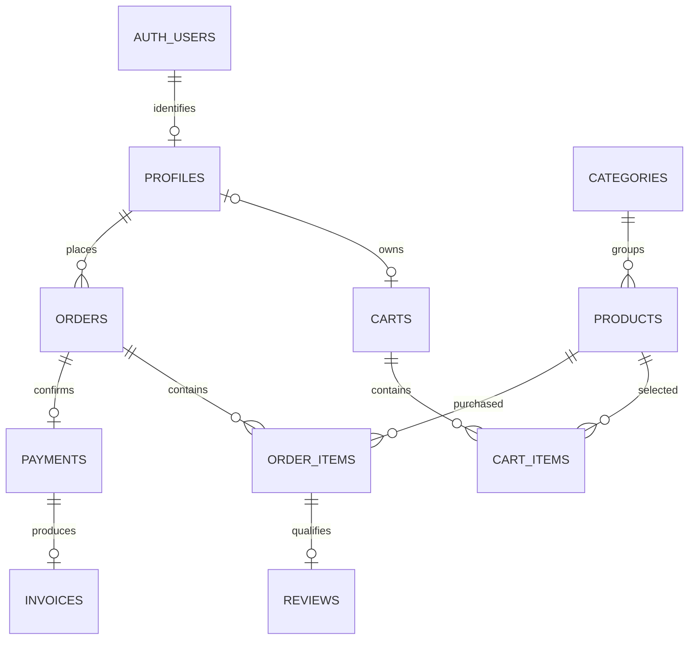

# RALLY database — SCRUM-12

The SQL migrations are the source of truth. The store uses Emre's existing
`public.profiles` UUIDs and Supabase Auth; it does not create another user or
password table. The NestJS backend connects through Prisma as the database owner.



Guest carts have no profile until login; they use a hashed guest token instead.

## Apply in order

1. `20261112150612_auth_profiles.sql` — existing authentication migration.
2. `20261112150641_auth_hook_search_path.sql` — existing hook fix.
3. `20261112192200_store_tables.sql` — categories, products, carts, orders,
   payments, invoices, reviews and delivery view.
4. `20261112192300_product_search_indexes.sql` — `pg_trgm` in `extensions`.

Use the team's configured Supabase migration workflow, or run the pending files
in this order in its SQL editor. Do not rerun migrations already applied. These
files assume Supabase's `auth.users`, `anon`, `authenticated` and
`supabase_auth_admin` already exist. PostgreSQL 15+ is needed for the view's
`security_invoker` option. The isolated test below was run on PostgreSQL 17.11.

The old `database/schema.sql` and `database/search-index.sql` were unmerged
standalone drafts and are replaced by these migrations. **If anyone already ran
the old schema manually, stop before applying the new migration.** Inventory and
back up its data, then agree a separate migration from its numeric users to real
profiles. Do not drop tables or invent UUID mappings. This migration deliberately
fails on existing store tables rather than silently keeping an incompatible schema.

## Identity and access

- `auth.users.id` → `profiles.id` → `carts.user_id` / `orders.customer_id` are UUIDs.
  Roles, encrypted tax IDs and profile details stay in Emre's profile model.
- All nine store tables have RLS enabled with no browser policies. All privileges
  on the tables, delivery view and their identity sequences are revoked from
  `anon`, `authenticated` and `PUBLIC`. The delivery view also uses invoker rights.
- This follows the existing **backend-only** design. The frontend must call
  NestJS APIs, not `supabase.from(...)`. The database owner bypasses RLS, so the
  backend must enforce customer ownership and staff roles on every request.
- No card data or passwords are stored in store tables. Invoice PDFs belong in
  private storage, and access must go through an authorized backend or expiring link.
- Orders retain customer/product/price snapshots. Deleting a profile with orders
  is blocked, including deletion cascading from `auth.users`. Account removal needs
  a separate retention/anonymization design; it must not erase order history.

This matches Supabase's documented separation of [grants and
RLS](https://supabase.com/docs/guides/api/securing-your-api) and PostgreSQL's
[invoker-rights views](https://www.postgresql.org/docs/current/sql-createview.html).
These are code-level protections; hosted project settings have not been verified.

## Backend and frontend contract

`backend/prisma/schema.prisma` mirrors the public tables. Run `npm ci` and
`npm run prisma:generate` in `backend` after pulling the branch. Do not run
`prisma db push` or Prisma Migrate: those do not capture the RLS, grants, SQL
checks, extension placement and view in these migrations. Plain `prisma db pull`
also fails on the existing `profiles` → `auth.users` cross-schema foreign key.
For inspection use `prisma db pull --print --schemas public,auth` against a
development database, and review the output without replacing the application
model or introducing direct Auth-table writes.

| Database / Prisma | Frontend / API handling still to implement |
|---|---|
| Profile UUID | Use the verified request user's ID; never trust a submitted customer ID. |
| BigInt product/cart/order IDs | Serialize to decimal strings. Current mock products use JS numbers; update their types and comparisons when wiring APIs, or validate safe-integer bounds before any conversion. |
| Decimal prices and generated `lineTotal` | Keep decimal arithmetic on the server. Send explicit decimal strings; format them for display. Never write `lineTotal`. |
| `imageUrl`, `stockQuantity`, `serialNumber`, `distributorInfo` | Map to the current UI's `image`, `stock`, `serial`, `distributor` fields, or change the UI contract explicitly. |
| Category relation | Return its name/slug rather than the numeric foreign key as a label. |
| `processing`, `in_transit`, `delivered` | Map to UI labels `Processing`, `In transit`, `Delivered`; handle cancellation separately. |
| Optional product cost | For profit reporting, default to 50% of the actual sale price if omitted. Snapshot effective cost when that feature is added; current tables only snapshot sale price. |

One product listing has one stock count; sizes/colours with independent stock
require a variants migration. Delivery is one order with one row per order line
in `delivery_list`; its `total_price` is that line's total.

## Business rules the APIs must implement

- Guest carts use a random cookie token; store only its 32-byte hash. At login,
  transfer the cart, or merge into the existing customer cart in a transaction,
  then retire the guest token. Check stock when adding items. Zero-stock products
  remain searchable but cannot be added to the cart.
- Checkout claims a unique `(customer_id, checkout_key)` before reducing stock.
  Lock/update products in a consistent ID order, guard stock, use server prices,
  and commit the order, lines, mock payment and invoice together. Failures roll
  everything back; retries return the existing order. Amount must equal the
  server-calculated total. The schema cannot enforce this cross-table rule alone.
- The UI prototype adds 8% tax. Tax/shipping amounts are not part of this schema;
  agree the calculation and add explicit snapshots before using that checkout UI
  with real orders. Do not silently charge a total different from the invoice.
- Send the invoice email after commit, retrying the same invoice if delivery fails.
- Only the purchaser of a delivered order may review it. The schema links reviews
  to a purchase but does **not** enforce delivery or the requesting user's identity.
  Ratings are visible immediately; comments require product-manager approval.
- The API enforces order transitions and staff roles. A status CHECK restricts
  values but does not enforce the transition sequence. Cancellation must be allowed
  only from processing and restore stock exactly once.
- Search active names/descriptions with parameterized `ILIKE`, including zero stock.
  Define popularity with the team (for example non-cancelled units sold), and map
  aggregate ratings/counts into the frontend. Do not expose pending comments.

Wishlist/discount/return/refund/support-chat tables remain later work. The shop
pages currently use mock data; adding this schema does not make them persistent.

## Repeatable integration check

Create a new **empty, local, disposable** PostgreSQL database with a name starting
`rally_test_`. It needs `pg_trgm` installed on the server and a test-only database
administrator connection (the fixture creates roles and schemas). Then:

```sh
cd backend
npm ci
RALLY_DATABASE_TEST_URL=postgresql://postgres@127.0.0.1:5432/rally_test_store npm run test:database
npm test
npm run test:e2e
npm run lint
```

The database test refuses remote hosts, other database names, and databases that
already contain application tables. It does not reset or delete an existing
database. Use a new empty database on each run. It installs **all** migrations,
including Emre's, then tests real Nest registration/JWT `/me` + Prisma + PostgreSQL,
cart ownership, orders/invoices/delivery, denied browser access, RLS fallback,
constraints, snapshots, rollback, concurrent stock/retry examples and search.

Only Supabase's external Auth API/JWKS are test doubles. `auth.users` is a minimal
local prerequisite, not the complete hosted Auth schema. The checkout helper is
a test of the required transaction pattern; there is no production checkout API
yet. A hosted login → cart → checkout → invoice test is still required after those
APIs and the real project configuration are available.

Verified on 12 November 2026: 13 database integration checks, 94 existing backend
unit tests and 23 existing HTTP tests passed. Backend build/lint and frontend
typecheck/production build passed. The local check uses PostgreSQL 17.11 and the
repository's locked dependencies. This is not a claim that the hosted store is ready.
